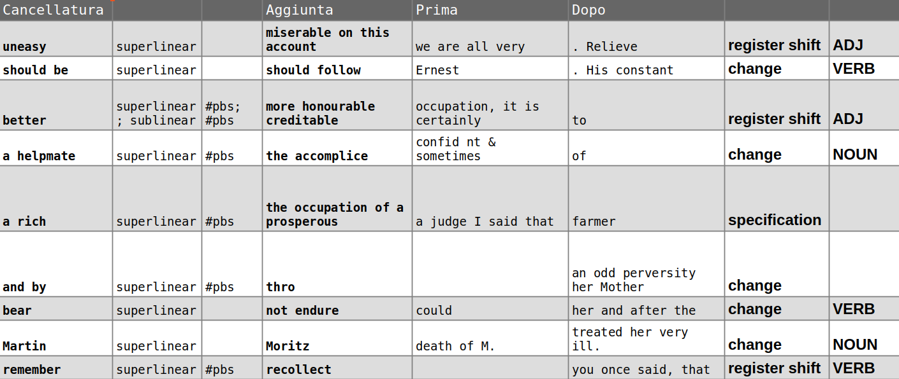

## Back to the past
- Results of MATTR on additional corpus --> data/additional/Cather-Fitzgerald-Hemingway.pdf
- Does it make sense to lemmatise before doing TF-IDF? 

## Manual classification

See https://shelleygodwinarchive.org/
- *Frankestein*: https://shelleygodwinarchive.org/contents/frankenstein/
- One notebook: https://shelleygodwinarchive.org/contents/ms_abinger_c56/
- One page: https://shelleygodwinarchive.org/sc/oxford/frankenstein/notebook/a/#/p5

Variants extracted (XML > CSV).

## Formal similarity
See [notebook](Variants-clustering.ipynb).

## Homeworks
- Find information about the writing of *Frankestein* and about the collaboration between Mary and Percy Shelley.
- Annotate 30 variants with the categories decided together and upload them to ILIAS (exercise: Create ground truth).
- Read:
  - Suddaby, Lee, and Gordon J. Ross. “Did Mary Shelley Write Frankenstein? A Stylometric Analysis.” *Digital Scholarship in the Humanities* 38, no. 2 (2023): 750–65. https://doi.org/10.1093/llc/fqac061. \[until section 3.1, then 8 and Appendix B\]

